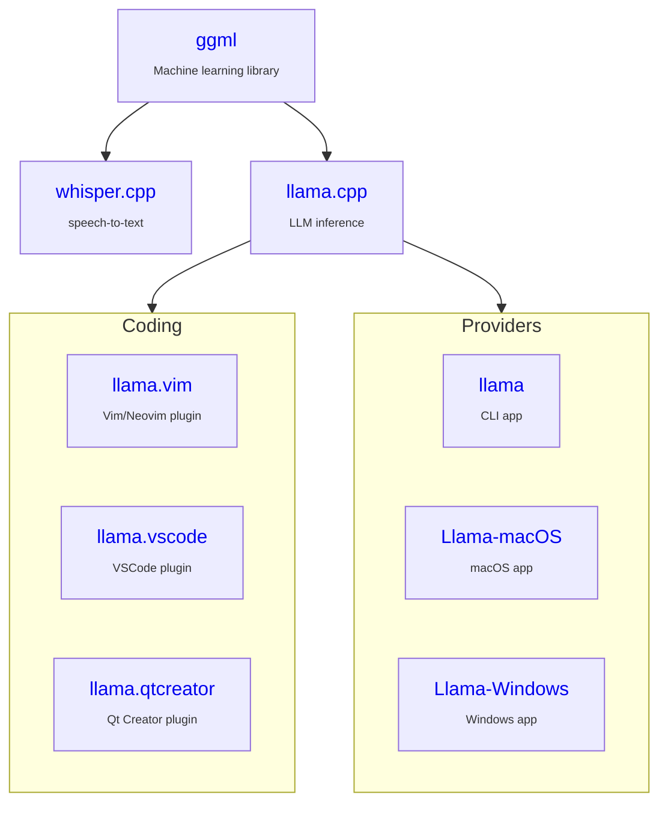

### Overview

The `ggml-org` organization on Github develops and supports the [ggml](https://github.com/ggml-org/ggml) machine learning library and related projects.

- https://huggingface.co/ggml-org - `ggml-org` at Hugging Face
- https://llama.app - `llama.cpp`'s official website

